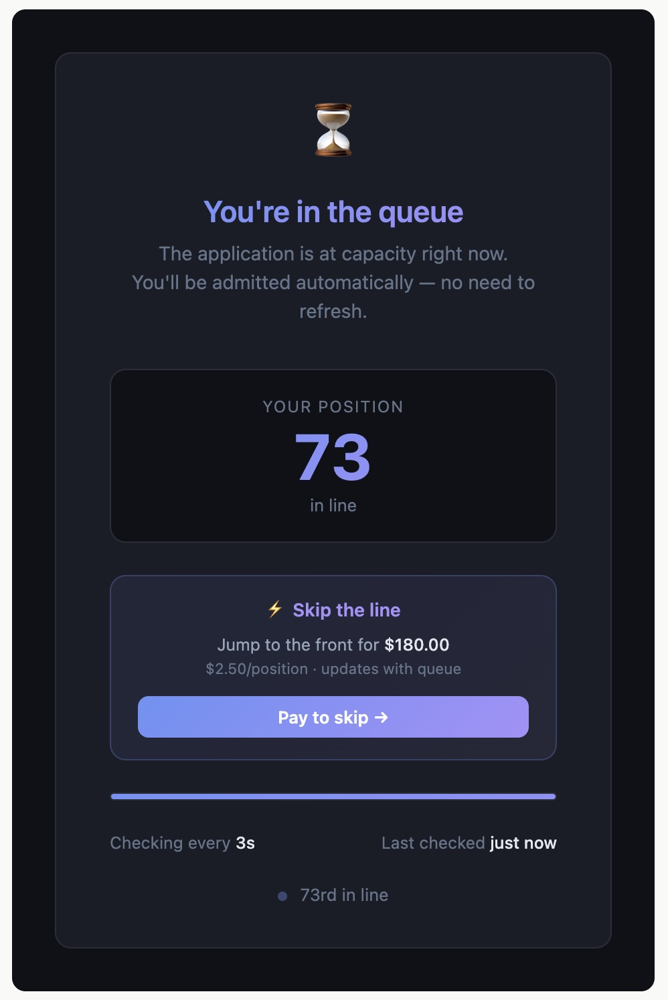

# room — FIFO Waiting Room for Go + Gin

> Drop-in waiting room middleware for [gin](https://github.com/gin-gonic/gin)
> web applications. Built on [sema](https://github.com/andreimerlescu/sema).

[](https://pkg.go.dev/github.com/andreimerlescu/room)
[](https://github.com/andreimerlescu/room/actions/workflows/go.yml)
[](LICENSE)
 

When your Go service hits capacity, don't drop requests — queue them.

`room` is a single-import middleware that sits in front of your Gin handlers
and turns excess traffic into an orderly waiting room. Every request gets a
ticket. Clients that can't be served immediately see a live-updating queue
page with their position. As slots open, they're admitted automatically in
ticket order. Your handlers never know the difference — they see normal
requests arriving at the rate you chose.

High-value clients can **skip the line** by paying a per-position fee, and
operators can move anyone forward for free. Paid clients receive a
**time-limited VIP pass** that auto-promotes them on re-entry. The line
survives restarts via **export/import**, and your application can list,
inspect and remove queued clients directly.

```go
wr := &room.WaitingRoom{}
wr.Init(500)
defer wr.Stop()
wr.RegisterRoutes(r)
// That's it. Request 501 sees the waiting room.
```

---

## See it in action — 30 seconds

```bash
cd sample/basic-web-app
bash test.sh
```

The test script builds the server, launches concurrent clients, and prints
a live dashboard while the waiting room queues and admits them. Open
`http://localhost:8080/` in your browser while it runs to see your position
tick down in real time.

---

## Why room?

When your application is at capacity you have three choices:

| Strategy | What happens | UX |
|---|---|---|
| **Drop (429)** | Reject the request | User sees an error, retries blindly, amplifies the spike |
| **Queue blindly** | Buffer with no ordering | No position awareness, users refresh and make it worse |
| **Waiting room** | Issue a ticket, show position, admit in order | User waits calmly, knows their place, gets in automatically |

`room` does the third, and is built for live events in front of fragile
origins: exactly-once ticket accounting so the line never stalls, cookies
that survive arbitrarily long waits, fast reclamation of clients that never
come back, a circuit breaker, runtime tuning of every setting, lifecycle
callbacks, an admin read/remove API, and a line that survives restarts.

---

## Installation

```
go get github.com/andreimerlescu/room@v1.7.0
```

Requires [gin](https://github.com/gin-gonic/gin) and the Go version declared
in `go.mod`.

---

## Quick start

```go
package main

import (
    "log"

    "github.com/andreimerlescu/room"
    "github.com/gin-gonic/gin"
)

func main() {
    r := gin.Default()

    wr := &room.WaitingRoom{}
    if err := wr.Init(500); err != nil {
        log.Fatal(err)
    }
    defer wr.Stop()

    // Registers GET /queue/status and attaches the middleware.
    // Every route registered AFTER this line is gated.
    wr.RegisterRoutes(r)

    r.GET("/", func(c *gin.Context) {
        c.String(200, "You're in!")
    })

    r.Run(":8080")
}
```

---

## What your users see



A queued request gets a self-contained HTML page that polls `/queue/status`
every 3 seconds (plus jitter) and updates the position in place. When the
server reports `ready`, the page reloads and the client is admitted.

- **Live position**, no refresh needed
- **Survives long waits** — the session cookies are re-sent while the client
  waits, so the browser never discards them
- **Survives server restarts** — failed polls are retried until the server
  answers again
- **Cookie detection** — clients whose browsers refuse cookies see an
  explanation instead of reloading forever
- **Skip-the-line offer** and **VIP pass badge** when configured
- **Accessible** — `aria-live` regions for screen readers

### Custom pages

Replace the page with `wr.SetHTML(myHTML)`. Placeholders:

| Placeholder | Replaced with |
|---|---|
| `{{.Position}}` | Client's queue position (integer) |
| `{{.SkipURL}}` | Payment page URL (empty string if not configured) |

Your page should poll `/queue/status` with a same-origin (or credentialed
cross-origin) `fetch`, so the cookie refreshes on poll responses are stored.
It should react to these JSON fields:

| Field | Meaning |
|---|---|
| `ready` | Reload now to be admitted |
| `position` | Current place in line (1 = next) |
| `cookies_required` | No `room_ticket` cookie arrived — stop polling and explain |
| `skip_cost`, `rate_per_pos` | Skip-the-line pricing (when configured) |
| `has_pass` | Client holds an active VIP pass |

Before its first poll, a custom page should also confirm that
`document.cookie` contains `room_probe`, and show an error instead of polling
if it doesn't.

---

## Tuning for live events

The defaults suit a general-purpose service. In front of a fragile origin
during a traffic spike, start here:

```go
wr.SetFirstPollGrace(30 * time.Second) // reclaim clients that never come back
wr.SetReaperInterval(30 * time.Second) // reclaim abandoned clients quickly
wr.SetMaxQueueDepth(20000)             // 503 new arrivals beyond this
wr.SetSecureCookie(true)               // behind TLS / a TLS terminator
```

| Setting | Default | What it controls |
|---|---|---|
| `SetTokenTTL` | 5m (`DefaultTokenTTL`) | How long an **abandoned** ticket lingers. It is a sliding window, reset on every poll, so waiting clients never expire. `0` restores the default. |
| `SetFirstPollGrace` | off | How long a new ticket may go without its client ever coming back (cookieless clients, bots, instant abandons) before it is reclaimed. The reaper runs at least this often while enabled. |
| `SetReaperInterval` | 5m (`DefaultReaperInterval`) | Cadence of eviction passes. `0` restores the default. |
| `SetMaxQueueDepth` | unlimited | Circuit breaker for new arrivals. |

Clients you already know are gone (banned, kicked) can be released
immediately with `RemoveToken`; see [Managing the line](#managing-the-line).

---

## Managing the line

### Reading it

```go
// The first 100 clients in line, cheap enough for an admin view every few seconds.
for _, t := range wr.Queue(100) {
    fmt.Println(t.Position, t.ClientKey, t.IssuedAt, t.LastPoll, t.Seen, t.HasPass)
}

// One client.
if t, ok := wr.Ticket(token); ok { ... }

wr.LiveQueueDepth() // clients holding a ticket
wr.QueueDepth()     // tickets ahead of a newcomer
```

`TicketInfo.Position <= 0` means the client has been told it is ready and has
not reloaded yet.

### Client keys

Record an application-defined key with every queued ticket — typically the
client IP as resolved by your trusted-proxy configuration:

```go
wr.SetClientKeyFunc(func(c *gin.Context) string { return c.ClientIP() })
```

The key appears in `TicketInfo.ClientKey` and `Snapshot.ClientKey`. Keys are
capped at 256 bytes.

### Removing tickets

```go
// Ban or kick one waiting client.
if err := wr.RemoveToken(token); err != nil {
    // room.ErrTokenNotFound: already gone or already being admitted — benign.
}

// Drop everyone behind a banned range in one call.
n := wr.RemoveTokensFunc(func(t room.TicketInfo) bool {
    return bannedRange.Contains(net.ParseIP(t.ClientKey))
})
```

A removed ticket frees its place immediately. Everyone behind it moves up at
once, nobody ahead moves, `QueueDepth` drops, and nobody is admitted early.
The removed client's next poll gets `ready:true` and its page reloads into
your handler — enforce bans upstream of the room if it must not re-queue.

### Moving clients forward

```go
// Operator "move to front" — no pricing, no payment, no RateFunc needed.
err := wr.AdminPromote(token, 1)
```

---

### Ranking clients

```go
// Rank a queued client: it waits ahead of every lower rank, behind every
// equal or higher rank, in arrival order within a rank.
moved, err := wr.SetTicketRank(token, 2)
```

Unlike promotions, which tie with the client already at the target position, a rank move inserts strictly: everyone it passes moves back one place, and every position stays exact. New arrivals always join behind ranked clients. Rank only moves a ticket forward; lowering it is recorded but doesn't move the ticket back. `TicketInfo.Rank` reports it, `EventRank` fires when a ticket moves, and ranks survive `Export`/`Import`.


## Skip the line — paid queue jumping

The cost to jump is `distance × rate`, where rate comes from your `RateFunc`.

```go
wr.SetRateFunc(func(depth int64) float64 { return 2.50 }) // $2.50 per position
wr.SetSkipURL("/queue/purchase")                         // "Pay to skip" button target

// Register payment routes BEFORE RegisterRoutes so they bypass the room.
r.GET("/queue/purchase", handlePurchasePage)
r.POST("/queue/purchase/confirm", handlePurchaseConfirm)
wr.RegisterRoutes(r)
```

Surge pricing receives the live queue depth:

```go
wr.SetRateFunc(func(depth int64) float64 { return 1.00 + float64(depth)*0.05 })
```

Quote read-only, then promote after payment:

```go
cost, err := wr.QuoteCost(token, 1)

result, err := wr.PromoteTokenToFront(token) // or wr.PromoteToken(token, 10)
if result.PassToken != "" {
    http.SetCookie(w, &http.Cookie{
        Name: "room_pass", Value: result.PassToken, Path: wr.CookiePath(),
        MaxAge: int(wr.PassDuration().Seconds()), HttpOnly: true, Secure: true,
    })
}
```

**Fairness.** A promotion lands exactly at the requested position, accounting
for tickets removed ahead of it. A later payer never lands ahead of an
earlier one to the same target; at most they tie, and tied clients are
admitted together.

### Stripe integration pattern

```go
r.GET("/queue/purchase", func(c *gin.Context) {
    cookie, _ := c.Request.Cookie("room_ticket")
    cost, _ := wr.QuoteCost(cookie.Value, 1)
    session, _ := stripe.CheckoutSessions.New(&stripe.CheckoutSessionParams{
        LineItems: []*stripe.CheckoutSessionLineItemParams{{
            PriceData: &stripe.CheckoutSessionLineItemPriceDataParams{
                Currency:   stripe.String("usd"),
                UnitAmount: stripe.Int64(int64(cost * 100)),
                ProductData: &stripe.CheckoutSessionLineItemPriceDataProductDataParams{
                    Name: stripe.String("Skip the line"),
                },
            },
            Quantity: stripe.Int64(1),
        }},
        Mode:              stripe.String("payment"),
        ClientReferenceID: stripe.String(cookie.Value),
        SuccessURL:        stripe.String("https://example.com/"),
        CancelURL:         stripe.String("https://example.com/"),
    })
    c.Redirect(http.StatusSeeOther, session.URL)
})

r.POST("/stripe/webhook", func(c *gin.Context) {
    event := verifyStripeSignature(c)
    token := event.Data.Object["client_reference_id"].(string)
    result, err := wr.PromoteTokenToFront(token)
    if err != nil { c.Status(400); return }
    // Webhooks can't set cookies; hand the pass to the client on the success page.
    storePassForClient(token, result.PassToken)
    c.Status(200)
})
```

---

## VIP passes — durable skip-the-line access

```go
wr.SetPassDuration(90 * time.Minute) // 0 disables (default); range 1m–24h
```

With passes enabled, every paid promotion returns a `PassToken`. Set it as
the `room_pass` cookie. Whenever that client re-enters the queue during the
pass window, it is auto-promoted to the front with no second payment.

Passes expire on the server as well as in the browser, and the reaper sweeps
expired ones. When a client holds a valid pass, `/queue/status` omits pricing
and reports `has_pass: true`.

---

## API clients and AI agents — keyed tickets

A browser keeps its place with a cookie. An API client or an AI agent calling
with a bearer token has no cookie jar, so v1.5.0 lets the application name a
ticket by a **key** instead — typically the ID of the client's token.

### Through the middleware

```go
wr.SetTicketKeyFunc(func(c *gin.Context) (string, bool) {
    id, ok := tokenIDFrom(c.GetHeader("Authorization")) // your lookup
    return id, ok // ok=false: the request uses the cookie flow as before
})
```

A request with a key never gets a cookie. The same key finds the same place
on every request, and a queued one is answered with:

```
HTTP/1.1 503 Service Unavailable
Retry-After: 3

{"waiting":true,"position":4,"queue_depth":120,"status_url":"/queue/status/9f…","retry_after":3}
```

`status_url` is a page a person can open to watch that place. It shows the
place, updates itself, and grants nothing: the ID in it is not the key and
cannot claim the ticket. Watching it never keeps the place alive — only the
client asking again does, within `TokenTTL`. Behind a proxy, or with the
routes mounted elsewhere, set the prefix: `wr.SetStatusBaseURL("https://example.com/wait/queue/status/")`.

Requests without a key are untouched: browsers get the waiting-room page.
To also send JSON to *cookie* clients that don't ask for HTML (`fetch`,
curl), opt in with `wr.SetWaitJSON(true)`; it is off by default. To write
the response yourself for every queued request, use `wr.SetWaitResponder`.

### Without the middleware

```go
ticket, place, err := wr.Enter(key) // join, or find your place; 1 is the front
place, ok := wr.Position(ticket)    // read-only
err = wr.Leave(key)                 // a key not in line is fine
```

`Enter` never admits anyone. It suits a server that decides for itself who
goes in — it keeps its own count, and calls `Leave` when a key starts. A key
that stops calling `Enter` for `TokenTTL` is reaped, and the keys behind it
move up. A place counts every ticket ahead, so with nobody admitted places
run 1, 2, 3… whatever the capacity. Place lookups run in `O(log N)` under a
read lock via the internal order-statistic tree.

### Leases: a slot held until you release it

```go
ok, place, err := wr.Acquire(key) // ok: the slot is yours until Release
err = wr.Release(key)
wr.Held()                         // slots held by leases
wr.SetLeaseTTL(4 * time.Hour)     // optional: reclaim leases nobody renews
```

A request holds its slot until its handler returns; a lease holds one until
`Release`, across any number of requests. Leases share the room's capacity
and its line, first come, first served: `Acquire` succeeds only when the
key's place has reached the serving window and a slot is free; otherwise the
key keeps (or takes) its place and `ok` is false. `Acquire` by a holder
renews its lease. With `SetTicketKeyFunc`, a holder's requests pass the
middleware without taking a second slot. `SetCap` below `Held()` revokes no
lease and grants no new slot until enough are released. Leases survive
`Export`/`Import`.

### Without gin

```go
mux.Handle("/wait/", http.StripPrefix("/wait", wr.Handler()))
wr.SetStatusBaseURL("/wait/queue/status/")
```

`Handler()` serves `GET /queue/status`, `GET /queue/status/{id}` and the
preflight under `net/http`. A `net/http` server drives the line with
`Enter`/`Leave` or `Acquire`/`Release`; the middleware itself is gin-only.

### One line per process

The line lives in memory. Two processes behind one load balancer keep two
lines, each with its own place 1 and its own capacity. If your service runs
several processes and the line must be shared, keep the line in shared
storage and use room per process only for what is local to it.

---

## Lifecycle callbacks

```go
wr.On(room.EventFull,  func(s room.Snapshot) { go provisionHost() })
wr.On(room.EventDrain, func(s room.Snapshot) { go deregisterHost() })
wr.On(room.EventQueue, func(s room.Snapshot) { metrics.Inc("room.queue") })
```

| Event | Fires when | `Token` / `ClientKey` (or `Key`) set |
|---|---|---|
| `EventEnter` | Request acquires a slot | — |
| `EventExit` | Request completes | — |
| `EventFull` | Room becomes full (edge) | — |
| `EventDrain` | Room stops being full (edge) | — |
| `EventQueue` | Request issued a waiting-room ticket | ✓ (+ `StaleTicket`) |
| `EventEvict` | Expired or never-seen ticket reclaimed | — |
| `EventTimeout` | Request cancelled before getting a slot | — |
| `EventPromote` | Paid, admin or VIP-pass promotion | ✓ |
| `EventRemove` | `RemoveToken` (one event, with token) / `RemoveTokensFunc` (one per call, no token) | ✓ for `RemoveToken` |
| `EventRank` | `SetTicketRank` moved a ticket ahead of lower ranks | ✓ |
| `EventLease` | `Acquire` granted a slot | `Key` |
| `EventRelease` | `Release` returned a slot | `Key` |
| `EventLeaseExpire` | The reaper returned a lease past `SetLeaseTTL` (one per lease) | `Key` |

For a keyed ticket, `EventQueue` and `EventRemove` (from `Leave`) carry
`Snapshot.Key` and leave `Token` empty: a keyed ticket's token is internal.

```go
type Snapshot struct {
    Event       Event
    Occupancy   int
    Capacity    int
    QueueDepth  int64
    Token       string // bearer credential — never log it
    ClientKey   string
    StaleTicket bool   // EventQueue: request carried an unrecognised room_ticket
    Key         string // keyed tickets and leases
}
```

`StaleTicket` separates two kinds of arrival:

- **`true`:** the client carried a `room_ticket` cookie the room no longer
  recognises — typically a returning visitor who was already admitted.
- **`false`:** the client carried no ticket cookie at all. The same
  `ClientKey` repeatedly arriving this way is a client discarding cookies.

Handlers run in their own goroutines. Keep handlers for high-frequency
events non-blocking.

---

## Surviving restarts

The line lives in memory. To keep it across a binary upgrade, export on
shutdown and import on startup:

```go
// Shutdown path.
_ = srv.Shutdown(ctx) // stop accepting, drain in-flight
tmp := path + ".tmp"
f, _ := os.OpenFile(tmp, os.O_CREATE|os.O_WRONLY|os.O_TRUNC, 0o600) // holds bearer tokens
if err := wr.Export(f); err == nil && f.Sync() == nil {
    f.Close()
    os.Rename(tmp, path)
}

// Startup path — settings FIRST, because Import uses TTL and grace to judge staleness.
wr.Init(cap)
wr.SetTokenTTL(ttl)
wr.SetFirstPollGrace(30 * time.Second)
if f, err := os.Open(path); err == nil {
    stats, err := wr.Import(f)
    f.Close()
    os.Remove(path)
    log.Printf("queue restored=%d dropped=%d passes=%d err=%v",
        stats.Restored, stats.DroppedStale, stats.PassesRestored, err)
}
wr.RegisterRoutes(r) // only now start serving
```

Import restores the line in order and handles a capacity change. It does not
charge the downtime against waiting clients, keeps passes to their real
expiry, re-sends each client's cookies on its first poll, and refuses a room
that has already served traffic.

**Keep the restart short.** Complete restarts well within two-thirds of the
token TTL (200 s at the default), because browsers keep counting cookie
lifetimes while the server is down.

---

## Runtime configuration

**Every setter is safe to call while traffic is flowing.** You can apply
setting changes live without restarting:

`SetCap`, `SetMaxQueueDepth`, `SetReaperInterval`, `SetTokenTTL`,
`SetFirstPollGrace`, `SetPassDuration`, `SetHTML`, `SetSkipURL`,
`SetRateFunc`, `SetClientKeyFunc`, `SetSecureCookie`, `SetCookiePath`,
`SetCookieDomain`, `SetTicketKeyFunc`, `SetWaitJSON`, `SetWaitResponder`,
`SetStatusBaseURL`, `SetLeaseTTL`.

Caveats:

- **Changing `SetCookiePath` or `SetCookieDomain` while clients are queued**
  strands them: their existing cookies no longer match.
- **A new `SetTokenTTL`** applies to cookie `MaxAge` from each client's next
  cookie refresh.
- **Not safe while serving:** `Init`, which runs once before traffic, and
  `Import`, which must run before serving.

```go
func onConfigReload(cfg Config) {
    wr.SetCap(int32(cfg.MaxConcurrent))
    wr.SetTokenTTL(cfg.TokenTTL)         // 0 = default
    wr.SetReaperInterval(cfg.Reaper)     // 0 = default
    wr.SetFirstPollGrace(cfg.FirstPoll)  // 0 = off
    wr.SetMaxQueueDepth(cfg.MaxQueueDepth)
    wr.SetPassDuration(cfg.PassDuration) // 0 = off
}
```

### Multiple engines

`RegisterRoutes` may be called on any number of `gin.Engine`s for the same
`WaitingRoom` — for example, one engine per configuration generation,
swapped atomically. It starts no goroutines, registers no callbacks and keeps
no per-engine state, so requests on an old engine and a new one share one
line. Calling it twice on the *same* engine panics, because gin rejects
duplicate routes.

### Changing capacity

```go
wr.SetCap(1000) // queued clients are admitted on their next poll
wr.SetCap(200)  // zero-over-admission graceful shrink
```

Growing capacity takes effect immediately. Shrinking is **graceful with zero
over-admission**: all in-flight requests and held leases are preserved, `Len()`
stays synchronized with active occupancy, `Utilization()` and
`UtilizationSmoothed()` stay clamped to `[0.0, 1.0]`, and no new slot is
granted until occupancy drops below the new capacity (when `EventDrain` fires
once).

---

## Long-lived connections (WebSockets, SSE)

A request admitted by the room holds its slot until its handler returns. For
a WebSocket or server-sent-events stream, that is the lifetime of the
connection, so a few hundred open sockets can consume the whole capacity and
freeze the line.

`room` deliberately does not special-case these. Keep them out of the room:

- **Register the routes before the room.** Routes registered before
  `RegisterRoutes` bypass the waiting room.

```go
  r.GET("/ws", wsHandler) // not gated
  wr.RegisterRoutes(r)
  r.GET("/", pageHandler) // gated
```

- **Or dispatch around it.** In a catch-all proxy, check the request before
  it reaches the room middleware (for example `Upgrade: websocket` or
  `Accept: text/event-stream`), and apply your own concurrency limit to those
  connections.

---

## How it works

```
 arrival ──▶ ticket = nextTicket+1 ──▶ ticket ≤ nowServing+cap ? ──yes──▶ acquire slot ──▶ handler ──▶ release: nowServing+1
                                            │ no
                                            ▼
                         token + cookies, waiting page ◀── poll /queue/status (sliding TTL, cookie refresh)
                                            │ ready
                                            ▼
                         reload with cookie ──▶ claim token ──▶ acquire slot ──▶ handler
```

| Layer | Responsibility |
|---|---|
| **Ticket counter** | Monotonic position on arrival |
| **Serving window** | `nowServing + cap` decides who may enter |
| **Semaphore** | Hard concurrency limit via [sema](https://github.com/andreimerlescu/sema) |
| **Token store** | Session cookie → ticket; one lock per status poll |
| **Ghost ledger** | Tickets that will never be admitted, skipped exactly when the window reaches them |
| **Reaper** | Reclaims expired and never-seen tickets and expired passes |
| **Promoter** | Target-exact, fair placement for paid and operator promotions |

### Exactly-once accounting

Every ticket ends its life exactly once. Either it is admitted, and its
release moves the window forward. Or it is retired — abandoned, expired,
removed, timed out — and the ghost ledger moves the window forward when it
reaches that number.

Every path that removes a queued ticket claims it with a single atomic
delete. When admission and eviction race for the same ticket, exactly one of
them accounts for it. This is what keeps a small-capacity line from freezing
when clients abandon at the moment they are told to come in.

---

## Security considerations

| Concern | How room handles it |
|---|---|
| **Cookie theft / replay** | 128-bit random tokens, `HttpOnly`, `SameSite=Lax`. Call `SetSecureCookie(true)` in production. |
| **Token exposure in code** | `Snapshot.Token`, `TicketInfo.Token` and export files carry bearer tokens. Don't log them; write exports with mode `0600`. |
| **Queue flooding** | `SetMaxQueueDepth` rejects new arrivals; `SetFirstPollGrace` reclaims clients that never return within seconds. |
| **Poll abuse** | Polls faster than one per second per token get 429 with `Retry-After`. The token is kept alive, so real clients are throttled, never dropped. |
| **Capacity integrity** | The semaphore is the hard limit; ledger accounting prevents both over- and under-admission. |
| **Promotion integrity** | Promotions are serialized and never re-insert a ticket that was removed or admitted concurrently. |
| **Pass expiry** | Enforced on the server, not only by cookie `MaxAge`. |
| **Keyed tickets** | A keyed ticket's token is never sent to the client, and a `room_ticket` cookie carrying one is treated as unknown, so it cannot claim the admission. The public ID in `status_url` only reads a place, is rate-limited to one view per second, and never keeps the place alive. Keys are capped at 256 bytes and rejected, never truncated, past that. |

---

## Upgrading from v1.6.0

Nothing is removed and no signature, cookie, endpoint, or callback changes.
Zero new dependencies are added.

- **`O(log N)` indexed token store and ghost ledger.** `tokenStore` and
  `ghostLedger` are now backed by internal randomized order-statistic treaps
  with lazy range-add and subtree `maxRank`, eliminating all `O(N)` full-map
  scans in `Enter`, `Acquire`, `Position`, `TicketByKey`,
  `GET /queue/status/{id}`, `SetTicketRank`, `Queue(limit)` (`O(log N + limit)`),
  and `Export` (`O(N)` pre-sorted) while keeping dense ticket semantics exact.
- **Parallel read-locked polling.** `GET /queue/status`, `GET /queue/status/{id}`,
  and repeat keyed calls (`Enter`, `Acquire`, middleware) now run under
  `RLock` + a per-node mutex instead of serializing on a global write lock.
- **Lazy-heap reaping & post-spike compaction.** `reapBatch` inspects only
  due entries via intrusive `issuedAt`-keyed min-heaps (`O(1)` when nothing is
  expired, `O(k log N)` bounded batches otherwise) with instant runtime
  `SetTokenTTL` / `SetFirstPollGrace` updates and automatic low-water map/heap
  compaction once spikes drain.

---

## Upgrading from v1.5.0

Nothing is removed and no signature, cookie, endpoint, or callback changes.

- **Zero-over-admission `SetCap` shrink.** Built on `sema v1.2.0`, shrinking
  capacity below current occupancy preserves all in-flight requests and leases
  without draining the semaphore, keeps `Len()` aligned with active occupancy
  and `Held()`, clamps `Utilization()` and `UtilizationSmoothed()` to
  `[0.0, 1.0]`, and blocks new admissions until occupancy drops below the new
  capacity.
- **Lease restore into smaller capacity.** `Import` now preserves semaphore
  occupancy when restoring more leases than the new room's capacity, keeping
  `Len()` and `Held()` aligned from startup.

---

## Upgrading from v1.4.0

Nothing is removed and no signature changes. Every existing request is
handled exactly as before unless you call one of the new setters.

- **New route.** `RegisterRoutes` and `NewWaitingRoom` also register
  `GET /queue/status/:ticket`. An engine that already has a route under
  `/queue/status/` panics there (gin rejects conflicting routes).
- **`Stop` waits** for the reaper goroutine to exit. v1.4.0 only cancelled
  it, so a reaper pass could still run after `Stop` — and race a following
  `Init`.
- **Export format.** Exports carry `key` and `id` for keyed tickets (an
  older room ignores them). An export taken while leases are held is
  version 2, which v1.4.0 refuses rather than drop the leases. Import
  accepts versions 1 and 2.
- **`ImportStats.LeasesRestored`**, **`TicketInfo.Key`/`ID`/`Place`** and
  **`Snapshot.Key`** are new fields; `Snapshot` stays comparable.
- **New events** `EventLease`, `EventRelease`, `EventLeaseExpire` come after
  `EventRank`, so existing `Event` values are unchanged.

New APIs: `SetTicketKeyFunc`, `TicketKeyFunc`, `Enter`, `Position`, `Leave`,
`TicketByKey`, `Acquire`, `Release`, `Held`, `HasLease`, `SetLeaseTTL`,
`LeaseTTL`, `SetWaitJSON`, `WaitJSON`, `SetWaitResponder`, `WaitResponder`,
`SetStatusBaseURL`, `StatusBaseURL`, `TicketStatusHandler`, `Handler`,
`MaxKeyLen`, and the errors `ErrInvalidKey`, `ErrQueueFull`, `ErrLeaseHeld`,
`ErrNoLease`, `ErrLeaseTTL`.

---

## Upgrading from v1.2.1

Nothing is removed and no signature changes. Behaviour changes, all fixes:

1. **Queue freezes fixed.** Abandoned tickets that were already inside the
   serving window used to be dropped without moving the window. That
   permanently cost one slot each, and at small capacities froze the line.
   They are now retired correctly. As a result, `EventEvict` fires in more
   cases (it now includes evictions discovered by a status poll), and
   `QueueDepth` drops as soon as a ghost is reclaimed.
2. **Long waits fixed.** `room_ticket` and `room_probe` expired in the
   browser after `TokenTTL` (5 minutes) even while the client was polling.
   That showed a "cookies required" error to anyone who waited longer.
   Both cookies are now re-sent on status polls (at most once per TTL/3) and
   on every waiting-page reload. **Status responses and reloads can now carry
   `Set-Cookie`.**
3. **Rate-limited pollers stay alive.** A 429 poll now refreshes the token's
   TTL.
4. **Promotion fairness fixed.** Later payers used to land ahead of earlier
   ones, and intermediate targets were ignored after any earlier promotion.
   Promotions now land exactly at the target; later payers tie at worst.
5. **Promotion race fixed.** A promotion racing a removal could resurrect the
   removed ticket.
6. **`SetTokenTTL(0)` and `SetReaperInterval(0)` restore the defaults**
   instead of returning an error.

New APIs:

- **Line management:** `RemoveToken`, `RemoveTokensFunc`, `Queue`, `Ticket`,
  `TicketInfo`.
- **Client keys:** `SetClientKeyFunc`, `ClientKeyFunc`.
- **Promotion:** `AdminPromote`.
- **Reclaiming ghosts:** `SetFirstPollGrace`, `FirstPollGrace`.
- **Restarts:** `Export`, `Import`, `ImportStats`.
- **Events:** `EventRemove`, and the `Snapshot.Token`, `Snapshot.ClientKey`
  and `Snapshot.StaleTicket` fields.
- **Defaults:** `DefaultTokenTTL`, `DefaultReaperInterval`.
- **Errors:** `ErrFirstPollGrace`, `ErrImportNotEmpty`, `ErrImportFormat`.
  `ErrNotInitialised` is now returned by the new methods and by
  `PromoteToken`/`QuoteCost` on an uninitialised room.

---

## API reference

```go
// ── Construction ──────────────────────────────────────────
room.NewWaitingRoom(r *gin.Engine, cap int32) gin.HandlerFunc
wr.Init(cap int32) error
wr.Stop()

// ── Routing ───────────────────────────────────────────────
wr.RegisterRoutes(r *gin.Engine)
wr.Middleware() gin.HandlerFunc
wr.StatusHandler() gin.HandlerFunc
wr.TicketStatusHandler() gin.HandlerFunc   // GET /queue/status/:ticket
wr.Handler() http.Handler                  // the status routes, for net/http

// ── Configuration (safe while serving) ────────────────────
wr.SetCap(cap int32) error
wr.SetHTML(html []byte)
wr.SetTokenTTL(d time.Duration) error        // 0 = DefaultTokenTTL
wr.SetReaperInterval(d time.Duration) error  // 0 = DefaultReaperInterval
wr.SetFirstPollGrace(d time.Duration) error  // 0 = off
wr.SetMaxQueueDepth(max int64) error
wr.SetSecureCookie(secure bool)
wr.SetCookiePath(path string)
wr.SetCookieDomain(domain string)
wr.SetClientKeyFunc(fn room.ClientKeyFunc)
wr.SetRateFunc(fn room.RateFunc)
wr.SetSkipURL(url string)
wr.SetPassDuration(d time.Duration) error    // 0 = off

// ── Introspection ─────────────────────────────────────────
wr.Cap() int32
wr.Len() int
wr.QueueDepth() int64
wr.LiveQueueDepth() int64
wr.Utilization() float64
wr.UtilizationSmoothed() float64
wr.TokenTTL() time.Duration
wr.ReaperInterval() time.Duration
wr.FirstPollGrace() time.Duration
wr.MaxQueueDepth() int64
wr.CookiePath() string
wr.CookieDomain() string
wr.SkipURL() string
wr.PassDuration() time.Duration
wr.HasValidPass(passToken string) bool
wr.Queue(limit int) []room.TicketInfo
wr.Ticket(token string) (room.TicketInfo, bool)

// ── Line management ───────────────────────────────────────
wr.RemoveToken(token string) error
wr.RemoveTokensFunc(match func(room.TicketInfo) bool) int
wr.AdminPromote(token string, targetPosition int64) error
wr.SetTicketRank(token string, rank int) (bool, error)

// ── Keyed tickets and leases ──────────────────────────────
wr.SetTicketKeyFunc(fn room.TicketKeyFunc)
wr.Enter(key string) (ticket string, position int64, err error)
wr.Position(ticket string) (position int64, ok bool)
wr.Leave(key string) error
wr.TicketByKey(key string) (room.TicketInfo, bool)
wr.Acquire(key string) (ok bool, position int64, err error)
wr.Release(key string) error
wr.Held() int32
wr.HasLease(key string) bool
wr.SetLeaseTTL(d time.Duration) error        // 0 = leases last until Release
wr.LeaseTTL() time.Duration

// ── Wait responses ────────────────────────────────────────
wr.SetWaitJSON(on bool)                      // JSON for non-HTML cookie clients; off by default
wr.WaitJSON() bool
wr.SetWaitResponder(fn room.WaitResponder)
wr.SetStatusBaseURL(base string)             // "" = "/queue/status/"
wr.StatusBaseURL() string

// ── Skip the line ─────────────────────────────────────────
wr.QuoteCost(token string, targetPosition int64) (float64, error)
wr.PromoteToken(token string, targetPosition int64) (room.PromoteResult, error)
wr.PromoteTokenToFront(token string) (room.PromoteResult, error)
wr.GrantPass() string

// ── Persistence ───────────────────────────────────────────
wr.Export(w io.Writer) error
wr.Import(r io.Reader) (room.ImportStats, error)

// ── Lifecycle callbacks ───────────────────────────────────
wr.On(event room.Event, fn room.CallbackFunc)
wr.Off(event room.Event)
```

---

## Testing

```bash
make all    # vet, test, race, fuzz (30s), bench
```

Measured on an Apple M4 Pro (`-14`). The HTTP benchmarks go through the full
gin stack and `httptest`.

```
BenchmarkStatusPoll_Accepted-14            	 1203224	       980.1 ns/op	    6928 B/op	      29 allocs/op
BenchmarkStatusPoll_RateLimited-14         	  391071	      3026 ns/op	    7014 B/op	      29 allocs/op
BenchmarkResumeRender-14                   	   50721	     24217 ns/op	   72754 B/op	      38 allocs/op
BenchmarkSlowPathIssue-14                  	  144732	      7615 ns/op	   72376 B/op	      31 allocs/op
BenchmarkEnter_ExistingKey_100k-14         	 7789317	       152.4 ns/op	       0 B/op	       0 allocs/op
BenchmarkView_TicketStatus_100k-14         	 7852430	       146.6 ns/op	       0 B/op	       0 allocs/op
BenchmarkSetTicketRank_100k-14             	 3317515	       384.6 ns/op	       0 B/op	       0 allocs/op
BenchmarkReap_NoExpired_100k-14            	11137540	       108.3 ns/op	       0 B/op	       0 allocs/op
BenchmarkStatusPoll_Parallel_100k-14       	 8128274	       150.4 ns/op	       0 B/op	       0 allocs/op
BenchmarkTokenStore_PollSequenceV121-14    	 4256713	       283.7 ns/op	       0 B/op	       0 allocs/op
BenchmarkTokenStore_PollSingleLock-14      	 7317097	       165.0 ns/op	       0 B/op	       0 allocs/op
BenchmarkAdvance_EmptyLedger-14            	532877623	         2.343 ns/op	       0 B/op	       0 allocs/op
BenchmarkPositionOf_Ledger1k-14            	234823434	         8.428 ns/op	       0 B/op	       0 allocs/op
BenchmarkQuoteCost-14                      	30778339	        39.48 ns/op	       0 B/op	       0 allocs/op
BenchmarkPromoteToken-14                   	 1000000	      1099 ns/op	     577 B/op	       3 allocs/op
BenchmarkPromoteTokenToFront-14            	 1000000	      1041 ns/op	     577 B/op	       3 allocs/op
BenchmarkGrantPass-14                      	 2632789	       461.5 ns/op	     185 B/op	       1 allocs/op
BenchmarkHasValidPass-14                   	34806316	        34.54 ns/op	       0 B/op	       0 allocs/op
BenchmarkQueue_100of100k-14                	  165769	      7095 ns/op	   40192 B/op	       2 allocs/op
BenchmarkRemoveToken-14                    	 1413392	       888.9 ns/op	      48 B/op	       1 allocs/op
BenchmarkRemoveTokensFunc_10k-14           	     578	   2028422 ns/op	 2368704 B/op	    1012 allocs/op
BenchmarkFastPath-14                       	  682732	      1784 ns/op	    5318 B/op	      13 allocs/op
BenchmarkQueueDepth-14                     	1000000000	         1.086 ns/op	       0 B/op	       0 allocs/op
BenchmarkUtilizationSmoothed-14            	1000000000	         0.7939 ns/op	       0 B/op	       0 allocs/op
```

Key numbers to plan around (at 100,000 queued clients):

- **Parallel status polls.** `poll`, `/queue/status/{id}` views, and repeat
  `Enter` calls run under `RLock` + a per-node mutex (~150 ns/op, 0 allocs
  under 14-way parallel load).
- **Admin reads & ranking.** `Queue(100)` over 100,000 queued clients takes
  ~7.1 µs without blocking status polls; `SetTicketRank` takes ~385 ns/op
  (0 allocs), and `reap()` with no expired entries takes ~108 ns/op.

---

## Sample app

[`sample/basic-web-app`](sample/basic-web-app/) walks through capacity
tuning, callbacks, skip-the-line pricing, VIP passes and custom HTML.

```bash
cd sample/basic-web-app
bash test.sh
```

\[ [Read the full tutorial →](sample/basic-web-app/README.md) \]

---

## License

Apache 2.0 — see [LICENSE](LICENSE).

---

*Built on [sema](https://github.com/andreimerlescu/sema) by
[Andrei Merlescu](https://github.com/andreimerlescu).*
